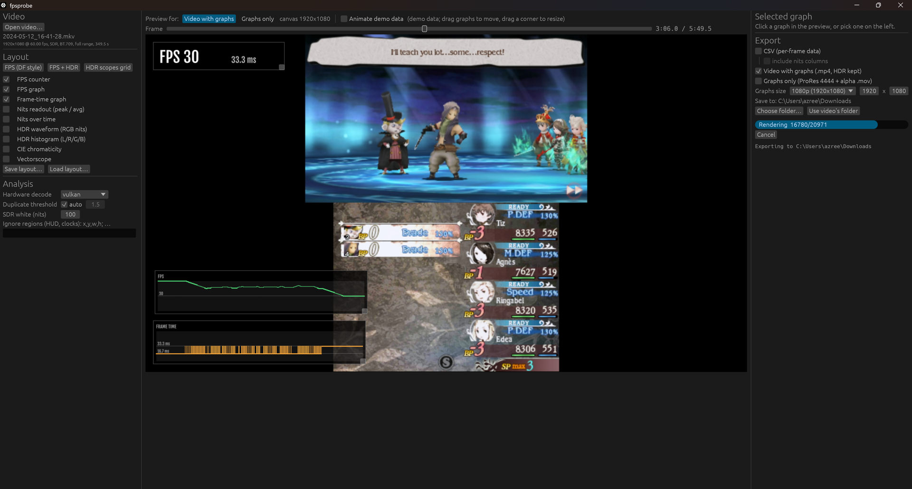
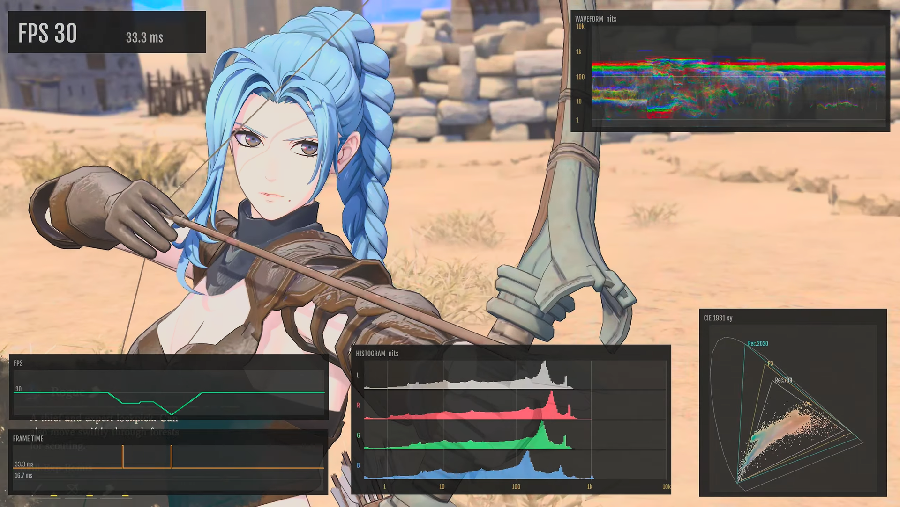

# fpsprobe

GPU-accelerated frame-rate, frame-time and HDR brightness analysis for captured gameplay video.

fpsprobe is built for real-world console captures, such as HEVC recordings from an Elgato 4K X. These are compressed, so repeated frames are never bit-identical. Instead of counting a frame as new when any pixel changes, fpsprobe measures each video's own compression-noise floor and separates real motion from noise.

<!-- MEDIA: uncomment once docs/media/demo-overlay.gif exists (see docs/media/README.md)
<p align="center">
  
</p>
-->

## Features

- **Frame rate and frame time** for compressed captures, with a noise-adaptive duplicate threshold.
- **GPU processing:** hardware video decode through FFmpeg (D3D11VA, CUDA, QSV or Vulkan) and frame comparison in a `wgpu` compute shader.
- **HDR brightness:** HDR10 (PQ), HLG and SDR. Reports peak and average luminance in nits, plus MaxCLL and MaxFALL.
- **HDR scopes:** RGB waveform in nits, L/R/G/B histogram, CIE 1931 chromaticity with Rec.709, P3 and Rec.2020 outlines, and a vectorscope.
- **Exports:**
  - CSV with per-frame data
  - the video with the graphs on top (HDR sources stay HDR10)
  - the graphs alone as ProRes 4444 with transparency, for DaVinci Resolve and other editors
- **GUI layout editor:** switch graphs on or off, then drag and resize them over a real frame of your video, chosen with a slider. Layouts save to JSON and can be reused from the command line.

## Screenshots

<!-- MEDIA: uncomment each image once its file exists in docs/media/ (see docs/media/README.md)

### Layout editor
<p align="center">
  
</p>

### Arranging graphs
<p align="center">
  
</p>

### HDR scopes
<p align="center">
  
</p>

### FPS and HDR overlay
<p align="center">
  
</p>

-->

## Requirements

- Windows 10/11 (other platforms are untested)
- [FFmpeg](https://ffmpeg.org/) (`ffmpeg` and `ffprobe`) on `PATH`
- A GPU supported by `wgpu` (DirectX 12 or Vulkan)
- [Rust](https://rustup.rs/), to build from source

## Building

```
cd fpsprobe
cargo build --release
```

This produces two programs in `fpsprobe/target/release/`:

| Program | Purpose |
|---|---|
| `fpsprobe-gui.exe` | Layout editor and exporter |
| `fpsprobe.exe` | Command line |

## Command-line examples

```powershell
# Frame-rate summary and per-frame CSV
fpsprobe.exe "capture.mp4" --csv "capture_fps.csv"

# Video with FPS and HDR graphs
fpsprobe.exe "capture.mp4" --nits --render "capture_analysis.mp4"

# Graphs only, transparent ProRes 4444, using a layout saved from the GUI
fpsprobe.exe "capture.mp4" --layout layout.json --graphs "graphs.mov" --graphs-size 1920x1080
```

Run `fpsprobe.exe --help` for all options, including `--ignore x,y,w,h`, which excludes HUD elements such as clocks or counters from frame comparison.

## Accuracy notes

- **Frame times are limited by the capture rate.** At 60 Hz they are always multiples of 16.7 ms, so record at 120 Hz for finer detail.
- **Nits come from the video signal, not from your display.** fpsprobe reports what the console sent; your TV may tone-map or clip it.
- **MaxCLL uses the brightest single colour channel,** following its CTA-861.3 definition, so it is usually much higher than the peak luminance.
- **Tearing isn't detected yet.**

fpsprobe is a free, open-source project and is not a certified measurement tool. Check its results before relying on them, especially in published comparisons.

## Acknowledgements

fpsprobe started as a fork of **[trdrop](https://github.com/cirquit/trdrop)** by **Alexander Isenko** ([@cirquit](https://github.com/cirquit)), a raw video frame-rate analysis tool built with Qt and OpenCV. The code has since been rewritten in Rust, but the idea of estimating a console's real frame rate by comparing captured frames comes from trdrop.

Thanks to everyone who contributed to trdrop and trdrop-redux, including Alexander Erben, David Maas, [illusion0001](https://github.com/illusion0001) and MujoA. Their full history is preserved in this repository's git log.

The overlay font is [Fjalla One](https://github.com/SorkinType/FjallaOne) by Sorkin Type, used under the SIL Open Font License 1.1 (see [fpsprobe/assets/fonts/OFL.txt](fpsprobe/assets/fonts/OFL.txt)).

## License

[MIT](LICENSE). The license keeps the original trdrop copyright notice, as the MIT terms require.
