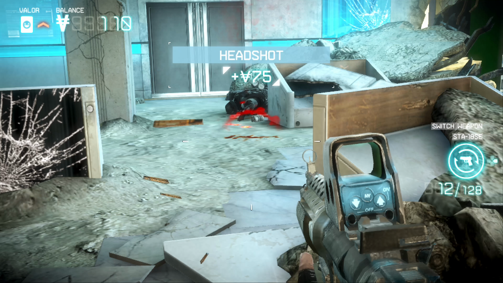
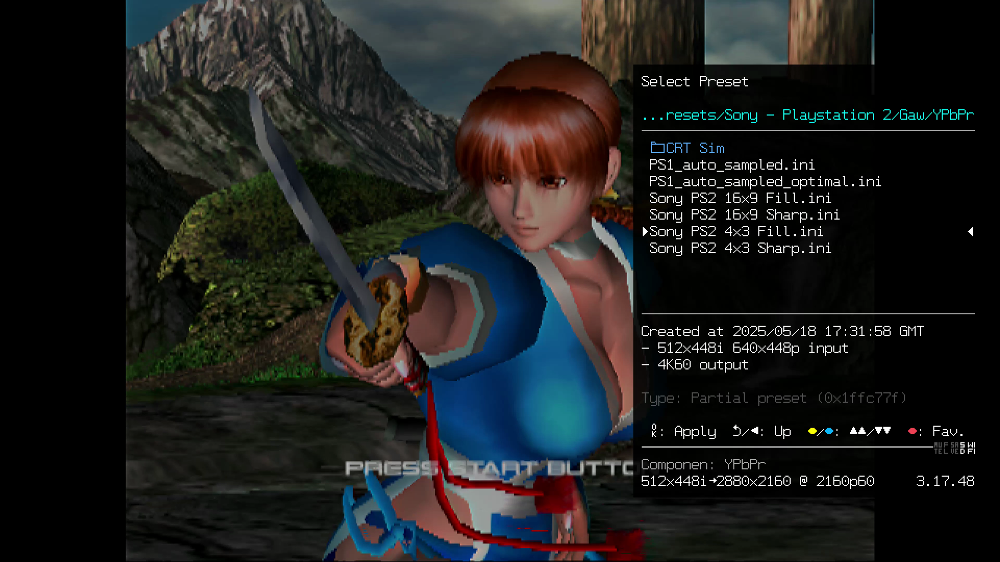

# fpsprobe

GPU-accelerated frame-rate, frame-time and HDR brightness analysis for captured gameplay video.

> fpsprobe is a Rust rewrite based on [trdrop](https://github.com/cirquit/trdrop) by Alexander Isenko. See [Acknowledgements](#acknowledgements).

fpsprobe is built for real-world console captures, such as HEVC recordings from an Elgato 4K X. These are compressed, so repeated frames are never bit-identical. Instead of counting a frame as new when any pixel changes, fpsprobe measures each video's own compression-noise floor and separates real motion from noise.

<p align="center">
  <picture>
    <source srcset="https://raw.githubusercontent.com/The1Azreen/fpsprobe/master/docs/media/overlay-fps-hdr.avif" type="image/avif">
    
  </picture>
</p>

<!-- MEDIA: swap the image above for this GIF once docs/media/demo-overlay.gif exists (see docs/media/README.md)
<p align="center">
  
</p>
-->

## Features

- **Frame rate and frame time** for compressed captures, with a noise-adaptive duplicate threshold.
- **GPU processing:** hardware video decode through FFmpeg (D3D11VA, CUDA, QSV or Vulkan) and frame comparison in a `wgpu` compute shader.
- **HDR brightness:** HDR10 (PQ), HLG and SDR. Reports peak and average luminance in nits, plus MaxCLL and MaxFALL.
- **HDR scopes:** RGB waveform in nits, L/R/G/B histogram, CIE 1931 chromaticity with Rec.709, P3 and Rec.2020 outlines, and a vectorscope.
- **Exports:**
  - CSV with per-frame data
  - the video with the graphs on top (HDR sources stay HDR10)
  - the graphs alone as ProRes 4444 with transparency, for DaVinci Resolve and other editors
- **GUI layout editor:** switch graphs on or off, then drag and resize them over a real frame of your video, chosen with a slider. Snap to a grid or align graphs to each other, nudge with the arrow keys, and lock graphs in place. Layouts save to JSON and can be reused from the command line.
- **Internal resolution detection (experimental):** estimates the game's rendering resolution for retro, interlaced and modern sources. See [below](#internal-resolution-detection-experimental-wip).

## Screenshots

### Layout editor
Graphs are arranged over a frame of the video, picked with the slider; the export runs in the background.
<p align="center">
  
</p>

**Placing graphs precisely:**

| Control | What it does |
|---|---|
| Hold **Shift** while dragging | Snap to the grid (size set in the toolbar, in output pixels) |
| Hold **Ctrl** while dragging | Align edges and centres to other graphs and to the canvas edges and centre |
| **Arrow keys** / **Shift + arrows** | Nudge the selected graph by 1 pixel / one grid step |
| **Lock layout** (toolbar) | Stop every graph from being moved or resized |
| **Locked** (inspector) | Lock just the selected graph |
| **Always snap to grid** (toolbar) | Snap without holding Shift; Shift then turns snapping off |

<!-- MEDIA: uncomment each image once its file exists in docs/media/ (see docs/media/README.md)

### Arranging graphs
<p align="center">
  
</p>

### HDR scopes
<p align="center">
  
</p>

-->

## Internal resolution detection (EXPERIMENTAL WIP)

> [!WARNING]
> **EXPERIMENTAL / WORK IN PROGRESS.** Results are estimates and can be wrong. Check them, for example with the GUI's pixel counter or your scaler's own status readout.

Upscaling leaves a repeating pattern in the picture: integer scaling repeats every pixel N times, and smooth scaling leaves fine detail on the original pixel grid. fpsprobe measures that pattern in sampled frames to estimate the game's native resolution. You choose the kind of source:

- **Retro:** integer-scaled consoles. Reports the exact scale factor and native resolution.
- **Interlaced:** 480i consoles through a deinterlacer such as a RetroTINK or Morph 4K. Reports lines per displayed frame and detects bob deinterlacing.
- **Modern:** dynamic-resolution games upscaled by 1–2×. Measures every sample, so you can see the resolution change over time.

```powershell
fpsprobe.exe "capture.mp4" --resolution retro|interlaced|modern --resolution-only --resolution-csv resolution.csv
```

In the GUI, tick **Show experimental features** at the bottom of the left panel (off by default), then open **Experimental: internal resolution**. On the command line it only runs when you pass `--resolution`.

### PlayStation Vita TV (Sharpscale), Killzone Mercenary
Detected **960×540 at integer ×4**: the Vita's native framebuffer integer-scaled to 4K.
<p align="center">
  
</p>

### PlayStation 2 through a Morph 4K, Dead or Alive 2
Detected **512×448** (scale ×5.63 by ×4.82), matching the Morph 4K's own status line in the corner: `512x448i → 2880x2160`. The Morph menu was excluded from the analysis with an ignore region.
<p align="center">
  
</p>

**Known limits:**
- **Analog horizontal resolution depends on your scaler's sampling.** For interlaced PS2 sources, the width reflects how many points per line the scaler samples, not necessarily what the game draws.
- **Modern reconstruction smooths away the pattern.** TAA, FSR and DLSS make modern results hints rather than measurements.
- **Encoder blocks can mimic common modern scales.** The video encoder compresses in 8- and 16-pixel blocks, so matches on that grid need much stronger evidence.
- **Overlays should be masked.** Mask HUDs and scaler menus with `--ignore x,y,w,h`; they're drawn at output resolution.

## Requirements

- Windows 10/11 (other platforms are untested)
- [FFmpeg](https://ffmpeg.org/) (`ffmpeg` and `ffprobe`) on `PATH`
- A GPU supported by `wgpu` (DirectX 12 or Vulkan)
- [Rust](https://rustup.rs/), to build from source

## Building

```
cd fpsprobe
cargo build --release
```

This produces two programs in `fpsprobe/target/release/`:

| Program | Purpose |
|---|---|
| `fpsprobe-gui.exe` | Layout editor and exporter |
| `fpsprobe.exe` | Command line |

## Command-line examples

```powershell
# Frame-rate summary and per-frame CSV
fpsprobe.exe "capture.mp4" --csv "capture_fps.csv"

# Video with FPS and HDR graphs
fpsprobe.exe "capture.mp4" --nits --render "capture_analysis.mp4"

# Graphs only, transparent ProRes 4444, using a layout saved from the GUI
fpsprobe.exe "capture.mp4" --layout layout.json --graphs "graphs.mov" --graphs-size 1920x1080
```

Run `fpsprobe.exe --help` for all options, including `--ignore x,y,w,h`, which excludes HUD elements such as clocks or counters from frame comparison.

## Accuracy notes

- **Frame times are limited by the capture rate.** At 60 Hz they are always multiples of 16.7 ms, so record at 120 Hz for finer detail.
- **Nits come from the video signal, not from your display.** fpsprobe reports what the console sent; your TV may tone-map or clip it.
- **MaxCLL uses the brightest single colour channel,** following its CTA-861.3 definition, so it is usually much higher than the peak luminance.
- **Tearing isn't detected yet.**

fpsprobe is a free, open-source project and is not a certified measurement tool. Check its results before relying on them, especially in published comparisons.

## Acknowledgements

fpsprobe started as a fork of **[trdrop](https://github.com/cirquit/trdrop)** by **Alexander Isenko** ([@cirquit](https://github.com/cirquit)), a raw video frame-rate analysis tool built with Qt and OpenCV. The code has since been rewritten in Rust, but the idea of estimating a console's real frame rate by comparing captured frames comes from trdrop.

Thanks to everyone who contributed to trdrop and trdrop-redux, including Alexander Erben, David Maas, [illusion0001](https://github.com/illusion0001) and MujoA. Their full history is preserved in this repository's git log.

The overlay font is [Fjalla One](https://github.com/SorkinType/FjallaOne) by Sorkin Type, used under the SIL Open Font License 1.1 (see [fpsprobe/assets/fonts/OFL.txt](fpsprobe/assets/fonts/OFL.txt)).

## License

[MIT](LICENSE). The license keeps the original trdrop copyright notice, as the MIT terms require.
